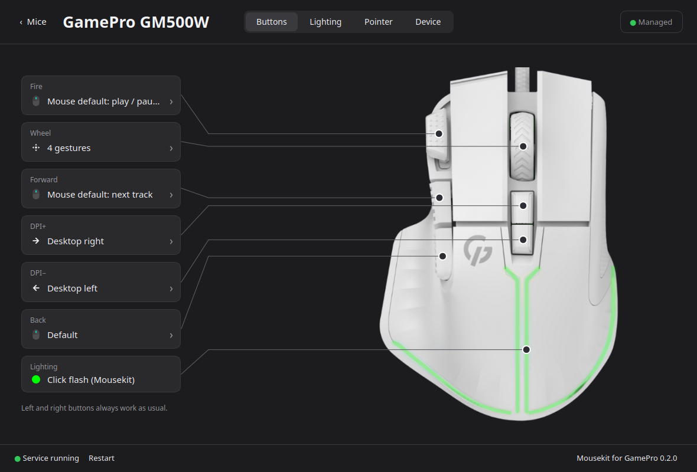
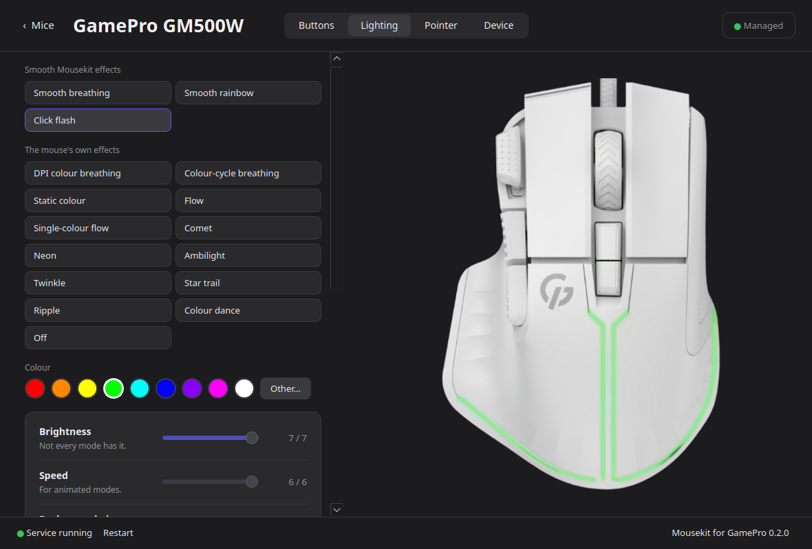

# Mousekit for GamePro

Lighting, DPI and button settings for **GamePro** gaming mice on Linux, plus gestures and button remapping
for any mouse. Made for KDE Plasma on Wayland.

GamePro's own app only runs on Windows. Mousekit speaks the mouse's protocol directly (worked out from that
app, see [docs/GM500W-PROTOCOL.md](docs/GM500W-PROTOCOL.md)) and can save the settings to the mouse itself.



## Supported mice

| Mouse | USB ID | Lighting | DPI | Hardware buttons |
|---|---|---|---|---|
| GamePro GM500W | `30fa:1440` | ✓ | ✓ | DPI+, DPI−, Fire, Forward |

Every other mouse gets button remapping and gestures. To get yours supported, see
[Support for another mouse](#support-for-another-mouse).

## Features

**GamePro GM500W**

- Lighting: the mouse's 14 built-in modes with colour, brightness, speed and direction, and smooth Mousekit
  effects (breathing, rainbow, a flash on every click and scroll).
- DPI: six stages from 200 to 12800. Turn stages on and off and choose the current one.
- Hardware buttons: give the DPI buttons any action (switching desktops by default), and Fire and Forward too.
- Saved to the mouse: lighting, DPI and buttons stay without Mousekit, on any computer.
- A picture of the mouse that shows its lighting and the buttons you press.

**Any mouse**

- An action per button: a KDE shortcut, a key combination, a command, another mouse button, precision mode
  (a slow pointer while held), or nothing.
- Hold a button and swipe in four directions, or turn the wheel, as in OpenLogi. For example, hold the wheel
  and swipe left or right to switch desktops. With Plasma's per-screen desktops, that's the screen under the
  cursor.
- Left and right buttons are never remapped. Touchpads, tablets and trackpoints are never touched.



## Install

Download `mousekit_…_all.deb` from [Releases](https://github.com/Athet-psl/mousekit-gamepro/releases/latest)
and install it:

```sh
sudo apt install ./mousekit_*_all.deb
```

Open **Mousekit for GamePro** from the app menu. If the service isn't running yet, press **Start** at the
bottom left. Then turn on **Manage this mouse** on the Device tab.

Mousekit is developed on Kubuntu 26.10 with Plasma 6.7 and needs Plasma 6. apt installs the rest
(`python3-evdev`, `python3-pyqt6`, `python3-dbus`). Other desktops aren't supported yet, see
[Issues and requests](#issues-and-requests).

**Updates:** the service checks for a new release every hour and shows a notification. **About** (bottom
right of the window) shows what's new and installs the update.

### From source

```sh
git clone https://github.com/Athet-psl/mousekit-gamepro && cd mousekit-gamepro
mkdir -p ~/.local/bin ~/.config/systemd/user ~/.local/share/applications
ln -sf "$PWD/bin/mousekit" "$PWD/bin/mousekitd" ~/.local/bin/
sed 's|/usr/bin/|%h/.local/bin/|' data/mousekit.service > ~/.config/systemd/user/mousekit.service
systemctl --user daemon-reload && systemctl --user enable --now mousekit.service
cp data/mousekit.desktop ~/.local/share/applications/
sudo cp data/70-mousekit.rules /etc/udev/rules.d/ && sudo udevadm control --reload && sudo udevadm trigger
```

## Support for another mouse

Mousekit learns a mouse from a description of its USB interfaces and a recording of what its buttons send.

1. In Mousekit, open the mouse, then **Device** › **Request support…**
2. Press **Record buttons** and press each button once.
3. Press **Open issue on GitHub**. The issue opens with everything filled in.

Without the app, `sudo mousekit --dump` writes the same into a text file. Either way, nothing is sent to
the mouse.

If you have Windows and the manufacturer's app, a USB capture of the app at work helps the most. The issue
form explains how to make one.

Once a model's protocol and memory layout are checked, it goes into [`mousekit/models.py`](mousekit/models.py).
Mousekit then recognises it when it connects, by its USB ID and, for models that share an ID, by a
fingerprint of its USB descriptors. Mice on the same chip (Instant, USB `30fa`) get live lighting before
that, but nothing is saved to them until their model is verified.

## How it works

- `mousekitd` runs as a systemd user service. It takes over the mice you enable (an evdev grab) and replays
  them through a virtual device with the same USB IDs, applying actions and gestures on the way. Shortcuts go
  through KDE's kglobalaccel over D-Bus. For the GM500W it also talks to the mouse's vendor HID interface,
  and to its keyboard interface, where the programmable buttons arrive as keys.
- `mousekit` is the settings app (PyQt6). Changes apply at once. Settings live in
  `~/.config/mousekit/config.json`.
- Access to the mice comes from udev `uaccess` rules for the logged-in user, so neither the `input` group
  nor root is needed.
- Every write to the mouse's memory is read back and checked before it's saved.

## Issues and requests

[Issues](https://github.com/Athet-psl/mousekit-gamepro/issues/new/choose) of any kind are welcome: bugs, ideas,
[another mouse](#support-for-another-mouse) or another desktop. Mousekit is made for KDE Plasma for now,
but most of it works below the desktop, so GNOME, Hyprland, Sway and others are possible: open a request
and say what you use.

## Development

```sh
python3 -m unittest discover tests
packaging/build-deb.sh 0.2.0      # builds dist/mousekit_0.2.0_all.deb
```

Every push to `main` runs the tests, builds the .deb and publishes it as release `v0.2.<commit count>`. The
release notes are the messages of the commits since the previous release, and the app shows them as the
changelog.

## Disclaimer

Not affiliated with or endorsed by GamePro. The protocol was worked out from the official app for
interoperability. Writing to a mouse's memory is at your own risk. Mousekit checks every write, and turning
off the DPI-button switch puts the factory assignment back.

The product image of the GM500W belongs to GamePro.

## License

[MIT](LICENSE)
